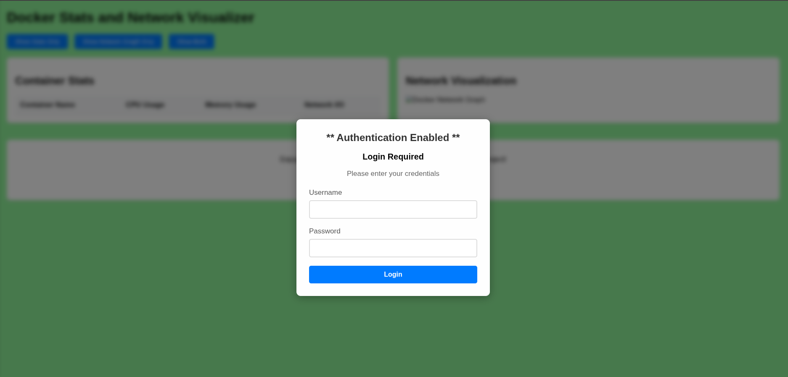
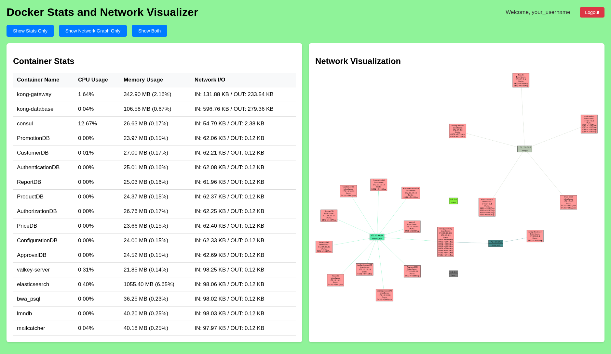
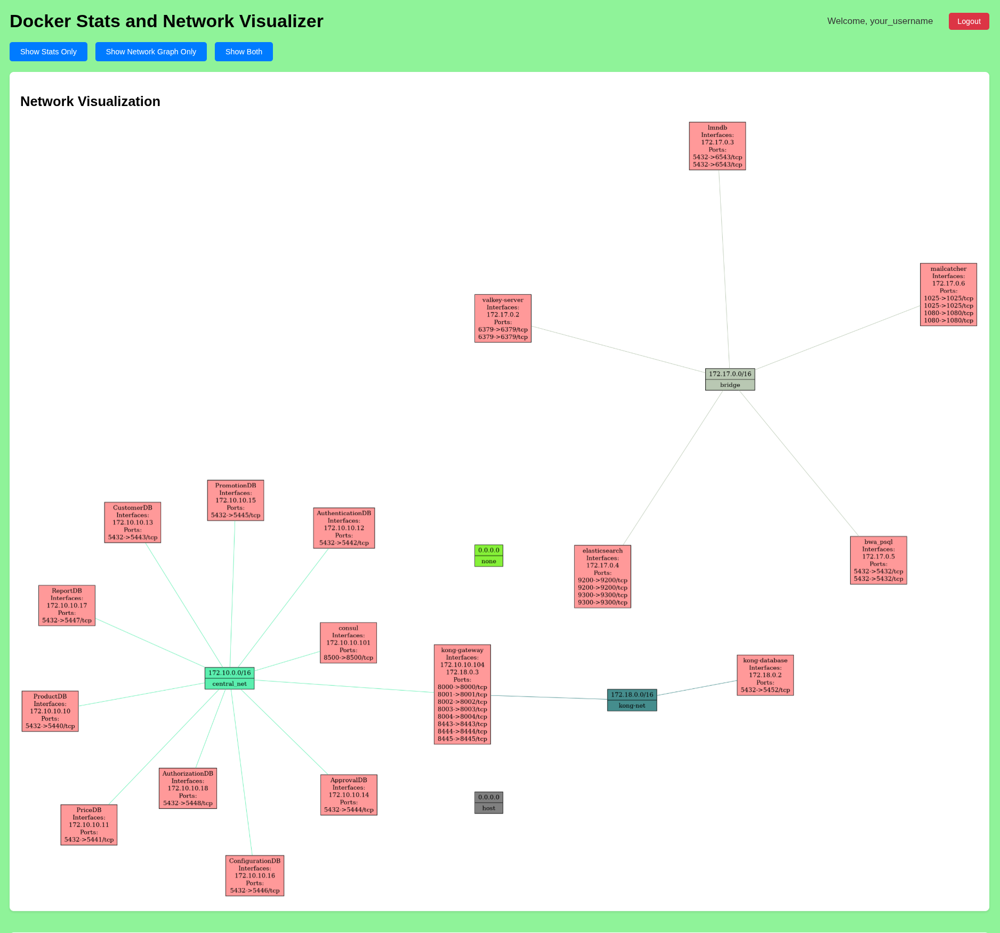
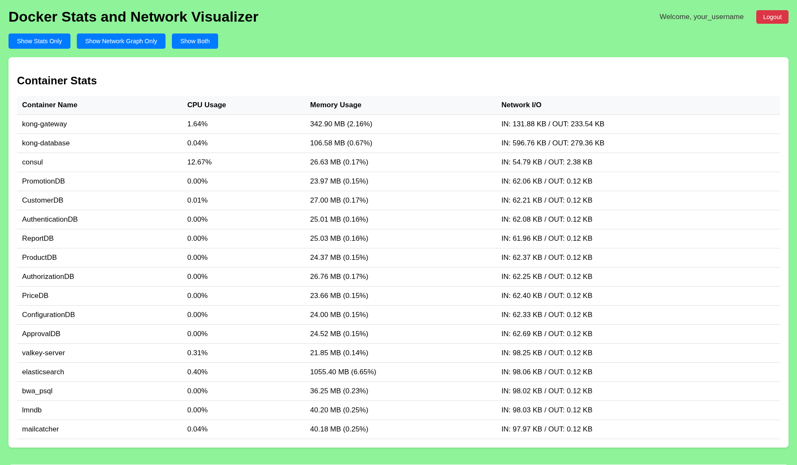

# **dStats**

**dStats** is a real-time web-based monitoring tool that provides performance stats for Docker containers and visualizes their network connectivity graph.

---
## **Run with Docker**
Pull and run the container from Docker Hub:

```bash
docker pull arifcse21/dstats:latest
```

Run the container with **NO** authentication, reachable only from this machine:

```bash
docker run -d --name docker-stats-web \
-v /var/run/docker.sock:/var/run/docker.sock \
--restart always \
-p 127.0.0.1:2743:2743 arifcse21/dstats:latest
```

Run the container with authentication:

```bash
docker run -d --name docker-stats-web \
-v /var/run/docker.sock:/var/run/docker.sock \
--restart always \
-p 2743:2743 \
-e USE_AUTH=true \
-e AUTH_USERNAME=<your_username> \
-e AUTH_PASSWORD=<your_password> \
arifcse21/dstats:latest
```

---

## Or You can run the Python pip package(requires Python 3.12+):
```bash
pip install dStats
```

Run the server (without authentication it is only reachable from this machine):
```bash
dStats.server
```

With Basic Authentication
```bash
USE_AUTH=true AUTH_USERNAME=<your_username> AUTH_PASSWORD=<your_password> dStats.server
```

## Configuration
All settings are environment variables (or a `.env` file in the working directory).

| Variable | Default | Purpose |
|---|---|---|
| `USE_AUTH`, `AUTH_USERNAME`, `AUTH_PASSWORD` | off | Require a login. Changing `AUTH_PASSWORD` or `AUTH_USERNAME` takes effect on restart and revokes the old credentials. |
| `DSTATS_HOST` | `127.0.0.1` without auth, `0.0.0.0` with auth (always `0.0.0.0` in the Docker image) | Interface to listen on. Without auth, dStats is only reachable from the same machine unless you set this. |
| `DSTATS_PORT` | `2743` | Port to listen on. |
| `DSTATS_ENGINE` (or `--engine`) | `docker` | Engines to monitor: `docker`, `podman`, or `docker,podman` for both. |
| `ALLOWED_HOSTS` | localhost names without auth, otherwise `*` | Comma-separated host names dStats answers to. |
| `CSRF_TRUSTED_ORIGINS` | none | Required for logging in over HTTPS behind a reverse proxy, e.g. `https://stats.example.com`. |
| `SECURE_COOKIES` | `false` | Set to `true` when serving over HTTPS. |
| `SECRET_KEY` | random per start | Set it to keep users logged in across restarts. |
| `DEBUG` | `false` | Development only; never enable on a reachable server. |

After 5 failed logins from one address, logins from it are refused for 5 minutes.

> **Security note:** dStats needs the Docker socket, and access to it is equivalent to root on the host.
> Expose dStats beyond your own machine only with authentication enabled, ideally behind HTTPS.

## Podman
dStats talks to Podman through its Docker-compatible API. Enable it once:
```bash
systemctl --user enable --now podman.socket     # rootless; for rootful: sudo systemctl enable --now podman.socket
```

Then monitor Podman, or Docker and Podman together:
```bash
dStats.server --engine podman
dStats.server --engine docker,podman             # toggle between them in the navbar
```

dStats finds the socket at `$XDG_RUNTIME_DIR/podman/podman.sock` (rootless) or `/run/podman/podman.sock` (rootful).
Set `CONTAINER_HOST` to use another one; `DOCKER_HOST` does the same for Docker.
Rootless Podman only shows the current user's containers.

Running dStats itself in a container with Podman:
```bash
podman run -d --name dstats --security-opt label=disable \
  -v $XDG_RUNTIME_DIR/podman/podman.sock:/run/podman/podman.sock \
  -e DSTATS_ENGINE=podman -p 127.0.0.1:2743:2743 arifcse21/dstats:latest
```
(`label=disable` lets the container use the socket on SELinux systems such as Fedora.)

## **Access the Application(Running on port 2743)**
- Open your browser and go to:  
  **http://localhost:2743**

---

## Example UI





Here, you’ll find:
1. **Container Stats:** Real-time CPU, memory, and network I/O usage.
2. **Network Graph:** Interactive map of containers and networks: zoom, pan and drag inside the panel, click for details.

---

## **Contribute to dStats Project**

Thank you for considering contributing to dStats! We appreciate all efforts, big or small, to help improve the project.

### **How to Contribute**

Setting up a development checkout, building packages, releasing, and working with Docker and Podman are covered in [DEVELOPMENT.md](DEVELOPMENT.md).

We believe collaboration is key to building great software. Here’s how you can get involved:

1. **Report Issues**  
   Found a bug? Have a feature request? Open an issue [here](https://github.com/Arifcse21/dStats/issues).

2. **Suggest Enhancements**  
   Have an idea for improvement? Share it by opening a discussion or issue.

3. **Contribute Code**  
   Whether it’s fixing bugs, adding features, or enhancing documentation, here’s how to start:
   - Fork this repository.
   - Clone your fork:  
     ```bash
     git clone https://github.com/Arifcse21/dStats.git
     cd dStats
     ```
   - Create a branch:  
     ```bash
     git checkout -b my-feature
     ```
   - Commit your changes:  
     ```bash
     git commit -m "Add my feature"
     ```
   - Push your branch:  
     ```bash
     git push origin my-feature
     ```
   - Open a pull request on GitHub.

4. **Improve Documentation**  
   Good documentation helps everyone. Spot typos? Want to clarify something? Update the `README.md` or other docs and send us a PR.

---

### **Need Help?**

Feel free to reach out by opening a discussion on the repository. We’re here to help!  

Thank you for being part of this project. Together, we can make dStats even better. 🎉

--- 
